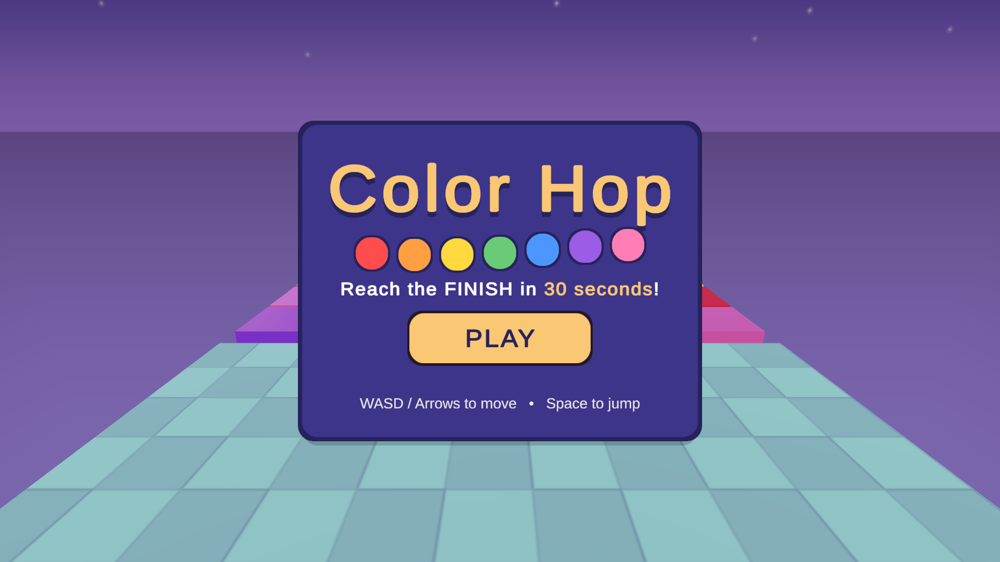
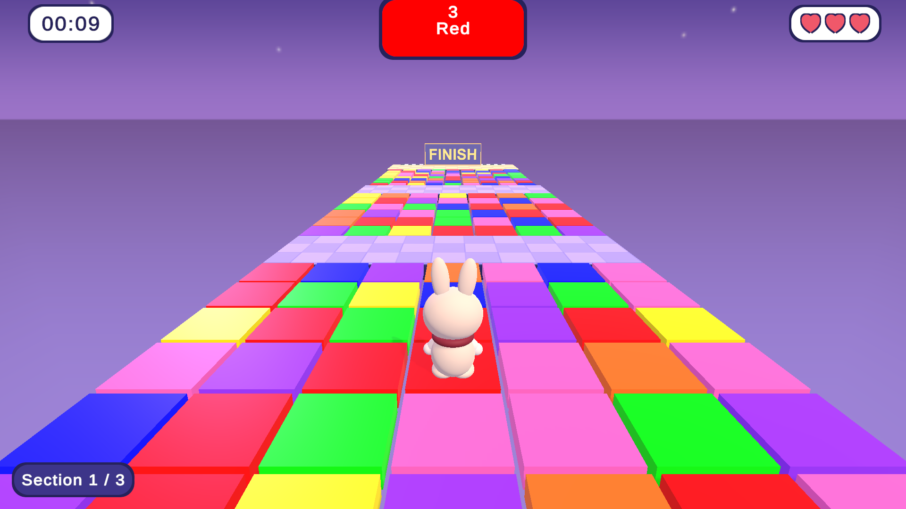
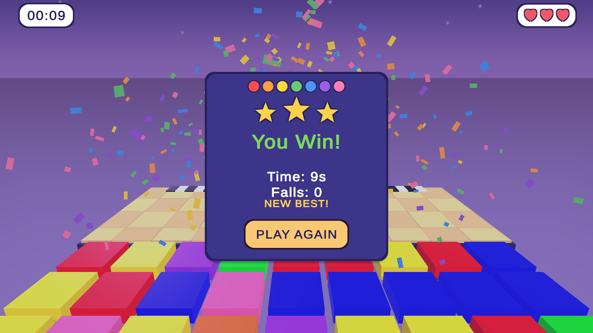
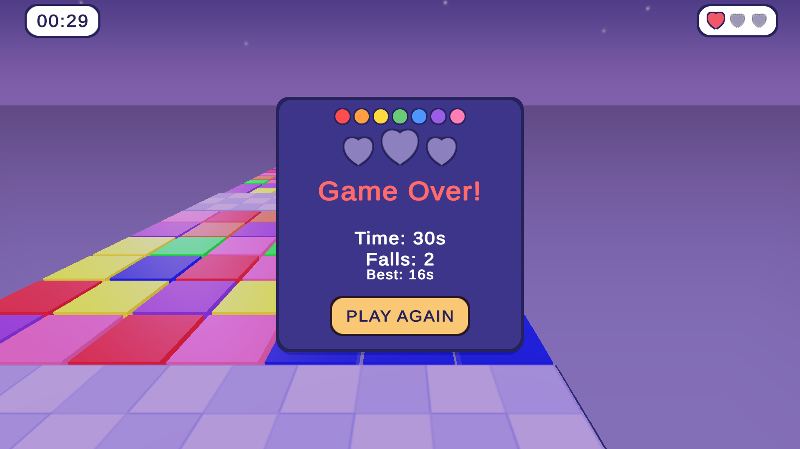

# 🐰 Color Hop

A cute 3D color-matching platformer made with **Unity 6**.
Help the bunny hop across a floating path of colored tiles. Every few seconds a color is called. Get onto a tile of that color before the countdown ends, or you'll fall!

> Made in the **Unity Game Development Bootcamp** by **Enjaz Club** at **Imam Mohammad Ibn Saud Islamic University (IMSIU)**.

---

## 📸 Screenshots

| Start screen | Gameplay |
|---|---|
|  |  |

| You win! | Game over |
|---|---|
|  |  |

---

## 🎮 Play the game

**[⬇️ Download the latest version](https://github.com/Amna-0/Color-matching-game/releases/latest)** (Windows)

1. Download the `.zip` file from the latest release.
2. Right-click it and choose **Extract All**.
3. Open the extracted folder and run the `.exe` file.

> If Windows shows *"Windows protected your PC"*, click **More info**, then **Run anyway**.

---

## 🕹️ How to play

- A **color name** and a **countdown** appear at the top of the screen.
- Move onto a tile of that color before the countdown reaches zero.
- When the countdown ends, every tile of a different color drops away.
- Cross the bridges and reach the **FINISH** before time runs out.
- You have **3 lives**. Each fall costs a heart.

| Key | Action |
|---|---|
| `W` `A` `S` `D` / Arrow keys | Move |
| `Space` | Jump |

---

## ✨ Features

- 🐰 A fluffy bunny with a burgundy scarf, built **entirely in code** with procedural fur, hopping, blinking and ear swings.
- 🌈 Seven colors with random rounds and tiles that wobble before they drop.
- ❤️ Lives shown as hearts, a timer, and a section indicator.
- ⭐ A win screen with a star rating, a saved **best time**, and confetti.
- 🔊 Sound effects generated in code, with no audio files.
- 🌌 A starry night sky, soft lighting and shadows, and cartoon-style platforms.

---

## 👩‍💻 Team

| Name | GitHub | LinkedIn |
|---|---|---|
| Amna Mohammed | [@Amna-0](https://github.com/Amna-0) | [LinkedIn](https://www.linkedin.com/in/amna-mohammed-612623381) |
| Leen Al Dahman | [@leendh23](https://github.com/leendh23) | [LinkedIn](https://www.linkedin.com/in/leen-al-dahman-54457741b) |
| Salma Alhababi | [@Sqqur000](https://github.com/Sqqur000) | [LinkedIn](https://www.linkedin.com/in/salma-alhababi-979a53421) |

---

## 🛠️ Built with

- **Unity 6** (Built-in Render Pipeline)
- **C#**
- **TextMesh Pro**

### Open the project
1. Clone the repository.
2. Open the folder in **Unity Hub** with **Add → Add project from disk**.
3. Open the scene `Assets/PlayerTest.unity` and press **Play**.
